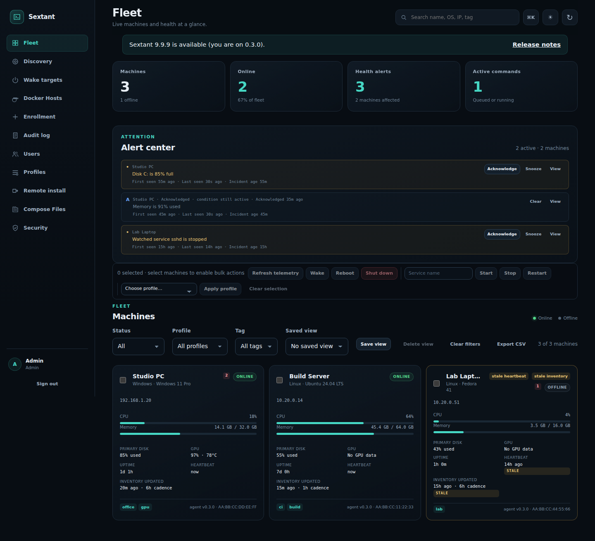
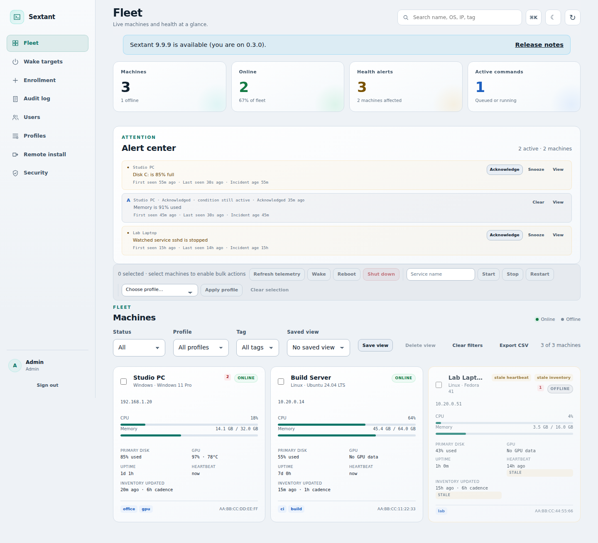
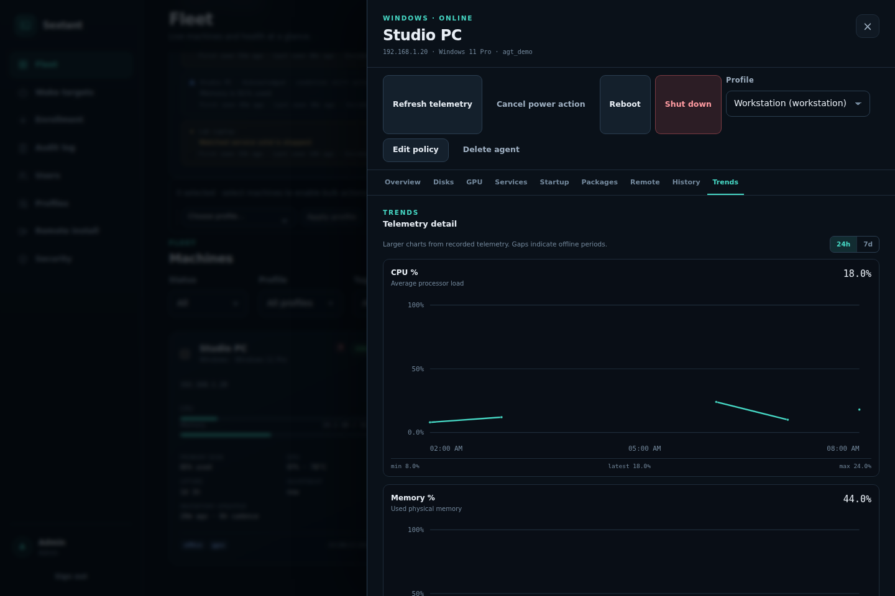
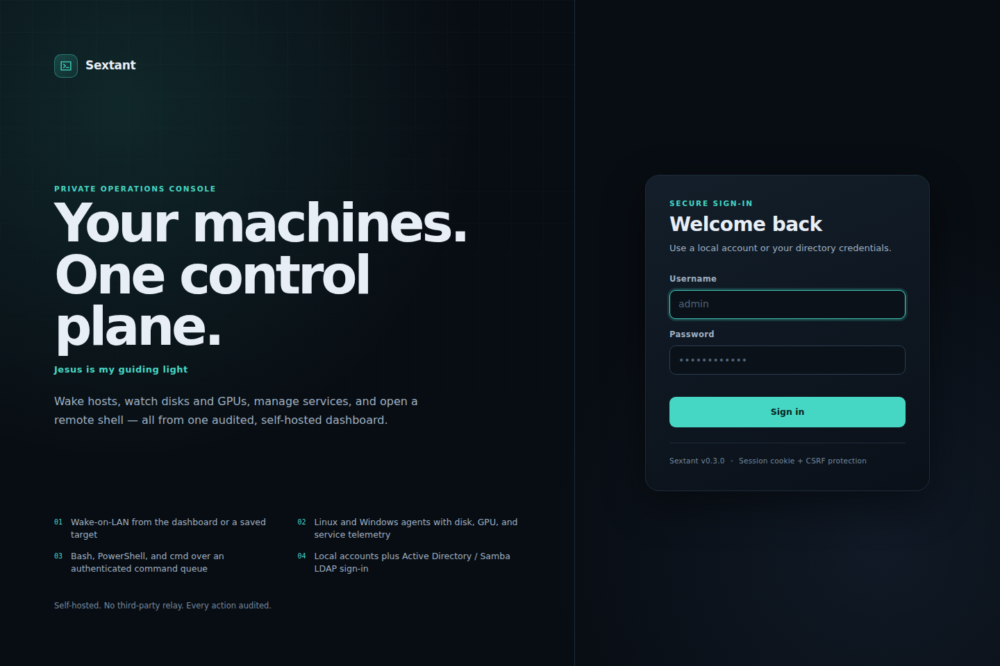
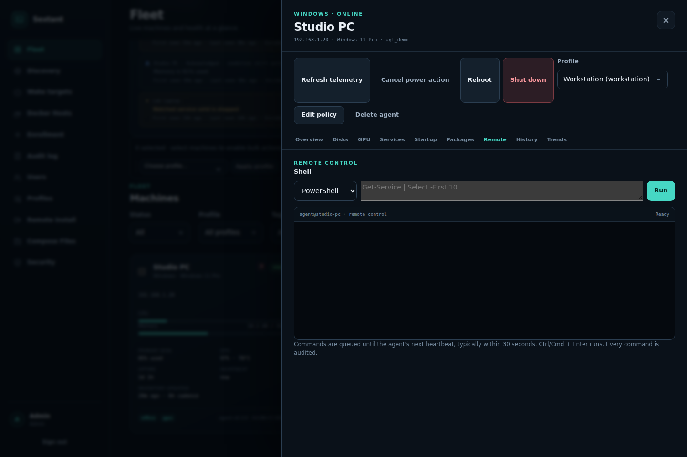

# Sextant

**Jesus is my guiding light.**

A self-hosted fleet operations console for a private network: a Linux server, cross-platform agents, and a web dashboard for wake-on-LAN, health monitoring, disk/GPU telemetry, service management, shutdown/reboot, and audited remote shells.

It is intentionally a single-tenant, self-hosted tool. There is no cloud relay. The server initiates nothing toward agents; agents make outbound authenticated HTTPS requests and pick up queued work.

> **Security first:** an operator account can execute arbitrary commands as the agent's OS user (root/SYSTEM by default). Read [docs/SECURITY.md](docs/SECURITY.md), put the console behind HTTPS and a VPN or trusted admin network, and do not expose it directly to the public internet.

## Screenshots

| Fleet dashboard (dark) | Fleet dashboard (light) |
| --- | --- |
|  |  |



*Gap-aware 24h/7d trends, a persistent state-change timeline, and the What changed summary.*

<details>
<summary>Login screen and remote terminal</summary>





</details>

## Live-tested on real hardware

Sextant 0.3.0 was installed and exercised on a Raspberry Pi — not a mock or a
container:

| Host | OS | Architecture | Python | Hardware |
| --- | --- | --- | --- | --- |
| `pivideo1` | Raspbian GNU/Linux 13 (trixie) | `armv7l` (32-bit) | 3.13.5 | Raspberry Pi, 920 MB RAM, 6.8 GB root disk |

The live run covered:

- a `py3-none-any` wheel install through the systemd installer;
- heartbeat telemetry for CPU, memory, both disks, **211 services**, and **962 apt packages**;
- a six-line shell command that streamed **12 stdout/stderr events once per second** before the final result;
- a dashboard SSE update within half a second of a command mutation, and stream closure on logout;
- self-update from 0.2.0 to 0.3.0 with SHA-256 verification, a staged venv, and a service restart;
- login, drawer tabs, trends, history, packages, services, live terminal, command palette, and both themes in Chromium.

Example install on a comparable Pi:

```bash
sudo SOURCE_DIR=/path/to/sextant-0.3.0-py3-none-any.whl \
  PROFILE=server \
  WATCH_SERVICES=ssh \
  AGENT_TAGS=raspberry-pi,armv7 \
  ./deploy/install-linux-agent.sh \
  https://ops.example.com \
  <ENROLLMENT_TOKEN> \
  pivideo1
```

The 32-bit `armv7l` result is expected: the agent is standard-library-only and the
wheel is platform-independent. An `arm64` Raspberry Pi OS install works the same
way.

## Features

- **Authentication and roles** — local accounts with scrypt password hashes, signed HttpOnly session cookies, CSRF protection, login rate limiting, failed-login auditing, and `admin` / `operator` / `viewer` roles.
- **Session and user administration** — server-side session registry with IP/user-agent, single-session and revoke-all controls, user disable/enable, and admin password reset. Password changes, admin resets, disabling a user, and revoke-all invalidate the relevant sessions.
- **Active Directory / Samba AD** — optional LDAP(S) bind authentication with group-to-role mapping and per-user provisioning.
- **Cross-platform agents** — Linux and Windows agents with outbound-only heartbeat/command polling and stable machine identity.
- **Wake-on-LAN** — server-side magic packets for agents (using their reported MAC) and for saved agent-less targets.
- **Discovery (D1–D3)** — default-off, CIDR-scoped inventory of unmanaged devices. Operators record an audited authorization acknowledgement, choose an allowlisted private scope, and run passive neighbour/DNS/OUI/SSDP collection plus opt-in TCP/banner/TLS fingerprinting. The page shows fleet counts, device types, open ports, linked agents/wake targets, and deduplicated new-device/new-port/service/identity/went-dark events. Scans run in a bounded background worker with a host cap, rate limit, progress, and cancellation. An eligible Linux agent can also be selected as the scan source for its own VLAN; it receives a validated `discovery.scan` over the existing outbound command channel and reports bounded results back. Local `allow_discovery`, profile `modules.discovery`, per-agent policy, and `SEXTANT_DISCOVERY_AGENT_RELAY` must all agree. Export, promotion, and integrations remain future phases.
- **Live health** — online/offline status, CPU, memory, uptime, disks, NVIDIA GPU utilization/VRAM/temperature, GPU compute processes, service states, and startup entries.
- **Docker Hosts** — Linux agents report Docker engine/Compose versions and a bounded inventory of containers, images, volumes, and networks. Select one host to inspect its environment, run allowlisted lifecycle/rename/update/remove/clone actions, view logs, use one-shot exec or the interactive console, and run cached cleanup previews with confirmed prune actions. The selected host refreshes automatically while visible; Compose config-hash drift is badged in Containers, Stacks, and deployment history.
- **Compose Files** — a server-side flat Compose library under a configurable directory with immutable revisions, `.env` redaction for non-admins, deploy/update/down/rollback to one or up to 20 Docker hosts with per-host results, deployment history/logs, and external-vs-managed project display. Image-based Compose only; build contexts and recreate-in-place from a full inspect spec are not implemented.
- **Interactive container console** — an operator can open a real `docker exec` PTY inside a running Linux container, type interactively, resize, copy/paste, and close it. The agent keeps heartbeating while the console runs; output/stdin are bounded in memory and no transcript is persisted by default.
- **Agent profiles** — server-managed behavior profiles (`workstation`, `server`, custom) control heartbeat, collection cadence, enabled modules, action gates, and update policy. Includes a dashboard editor and tag-based assignment.
- **Remote install (Linux)** — install an agent on a fresh Linux host over key-based SSH, with prerequisite checks, job log, and one-time enrollment.
- **Telemetry history** — bounded per-heartbeat samples with configurable retention and a downsampled history API for trend queries.
- **Package store (Tier 0)** — self-hosted, content-addressed artifacts with SHA-256 integrity; hosts agent wheels and internal app packages.
- **Package inventory and desired state** — read-only apt/winget inventory, per-device install/remove/upgrade sync, and a device Packages tab.
- **Agent self-update** — pulls the agent wheel from the store, verifies SHA-256, stages, health-checks, and switches on Linux and Windows.
- **Server update check** — read-only GitHub/static-feed check with an admin login banner (notify only).
- **Disk and GPU alerts** — thresholds for disk, memory, GPU temperature, and monitored services.
- **Telegram notifications** — background evaluation of offline, disk, memory, GPU, and watched-service conditions with per-incident deduplication, recovery messages, delivery retries, and a `sextant notify-test` command. Configured with environment variables; other channels and the rules UI are planned.
- **Service management** — start, stop, restart, enable, or disable systemd units and Windows services.
- **Remote shell** — queued Bash, PowerShell, or Windows `cmd` execution from the browser with output capture and command history.
- **Command guardrails** — per-agent queue caps, offline-command policy, cancel queued work, retry failed/cancelled work, and stale-command expiry.
- **Power control** — shutdown, reboot, and cancel scheduled power actions, per machine.
- **Editable agent policy** — server-side tags, notes, watched services, and shell/power/service permissions; local agent policy can always restrict further.
- **Audit log** — logins, failed logins, sessions, enrollments, wake packets, commands, user changes, and agent token changes.
- **Enrollment security** — one-time enrollment tokens; per-agent bearer tokens stored only as SHA-256 hashes; token rotation, re-enrollment deduplication, and agent revocation.
- **No inbound agent ports** — only outbound HTTPS from each agent.

## Architecture

```text
                         admin browser
                              │ HTTPS
                              ▼
                    ┌───────────────────┐
                    │ nginx / TLS       │
                    └─────────┬─────────┘
                              │ 127.0.0.1:8080
                    ┌─────────▼─────────┐
                    │ Sextant Console   │
                    │ FastAPI + SQLite  │◄──── LDAP(S) ──── AD / Samba AD
                    │ dashboard + API   │
                    └──────┬──────┬─────┘
             outbound HTTPS│      │ UDP magic packet
                    ┌──────▼──┐ ┌─▼──────────────┐
                    │ Linux   │ │ Wake-on-LAN    │
                    │ agent   │ │ capable PCs    │
                    └─────────┘ └────────────────┘
                    ┌─────────┐
                    │ Windows │
                    │ agent   │
                    └─────────┘
```

Agents heartbeat on an interval (default 30 seconds). The heartbeat uploads telemetry and returns queued commands. The agent executes a command, then posts the exit code and bounded stdout/stderr back to the server. No inbound port is opened on the endpoint.

## Quick start (development)

For a production server and agent installation, see **[docs/INSTALL.md](docs/INSTALL.md)**.

Requirements: Python 3.11+.

```bash
python3 -m venv .venv
.venv/bin/pip install -e '.[dev]'
source .venv/bin/activate

export SEXTANT_DATA_DIR="$PWD/data"
export SEXTANT_ADMIN_PASSWORD='a long password for local admin'
.venv/bin/sextant serve --host 127.0.0.1 --port 8080
```

Open <http://127.0.0.1:8080>, sign in as `admin`, then create an enrollment token under **Enrollment**. On a Linux target:

```bash
./deploy/install-linux-agent.sh http://127.0.0.1:8080 <TOKEN> my-linux-box
```

Or enroll manually:

```bash
sextant-agent enroll --server http://127.0.0.1:8080 --token <TOKEN> --name my-linux-box --watch-service ssh
sextant-agent run --config /etc/sextant-agent/config.json
```

For a Windows target, run PowerShell as Administrator:

```powershell
.\deploy\install-windows-agent.ps1 -Server https://ops.example.com -Token <TOKEN> -Name "Studio PC" -WatchServices Spooler
```

The development server uses HTTP. Put TLS in front of it for any real deployment; see [docs/DEPLOYMENT.md](docs/DEPLOYMENT.md).

## Tests

```bash
.venv/bin/pytest -q
.venv/bin/python -m pyflakes sextant_control sextant_agent tests
.venv/bin/python -m compileall -q sextant_control sextant_agent
node --check sextant_control/static/app.js

cd ui-tests
npm ci
npm test
npx playwright install chromium
npm run test:visual
```

The Python suite has **375 tests** (374 run on Linux; one Windows-only junction test is skipped there and runs on the Windows CI job). It covers password/session/CSRF security, the API RBAC and authentication contract, local and AD login, session revocation, user disable/reset, failed-login audit, enrollment, heartbeat, command dispatch/idempotency/cancel/retry/expiry, queue caps, offline policy, agent policy, re-enrollment deduplication, WoL, audit logging, agent parsers, executor behavior, config handling, the Tier 0 package store, server update checks, agent self-update on Linux and Windows, package inventory/desired-state sync, agent profiles, revisioned inventory, Docker detection/inventory/actions/exec/console/clone/cleanup/API gating, multi-host deploy partial failure, Compose storage/revisions/deploy/bundle/gating, config-hash drift, health-event deduplication, Telegram notification evaluation/deduplication/retry, key-based SSH remote install, discovery CIDR/scope validation, merge/classification/event deduplication, scan lifecycle/cancellation, RBAC/CSRF, acknowledgement auditing, retention, and agent-relayed discovery config/gates, report bounds/ownership, source/segment attribution, atomic dedupe, and local denial.

The jsdom smoke test loads the real dashboard and verifies the fleet, live SSE fallback, drawer, paginated history, trends, timeline, alert lifecycle, bulk actions, saved views, policy/user/session dialogs, GPU process list, remote terminal, Docker Hosts list/detail/refresh/empty/auto-refresh plus drift badges, inspect, logs, exec, console open/input/close, clone validation/warning, remove, cleanup, offline-disabled, and Compose Files list/editor/revisions/multi-host-deploy/per-host-summary/deployment-history states, and Discovery summary/filters/table/drawer/edit/server-and-agent scan source/start/cancel/relay-disabled/disabled/unacknowledged states. The **22 Playwright + axe-core tests** cover dark/light themes at desktop and mobile widths, login, dashboard, drawer tabs, command-palette keyboard flow, focus trap/return, Docker Hosts fast refresh/drift/safe clone dialog, inspect/cleanup confirmation, Compose Files deploy controls, interactive console open/output/close, Discovery inventory/drawer/server-and-agent scan/relay-disabled/disabled states, and serious/critical accessibility violations.

A real end-to-end server/agent smoke test is described in [docs/DEPLOYMENT.md](docs/DEPLOYMENT.md#validation), and the Raspberry Pi run is recorded in [docs/TESTING.md](docs/TESTING.md#manual-live-validation). See [docs/TESTING.md](docs/TESTING.md) for the full coverage gaps.

## Configuration

All server configuration is environment variables. The common ones:

| Variable | Default | Purpose |
| --- | --- | --- |
| `SEXTANT_DATA_DIR` | `./data` | SQLite DB, server secret, bootstrap admin file |
| `SEXTANT_PUBLIC_URL` | empty | Public base URL used in enrollment commands |
| `SEXTANT_COOKIE_SECURE` | `0` | Set to `1` when serving over HTTPS |
| `SEXTANT_TRUST_PROXY` | `0` | Trust `X-Forwarded-For` / proxy headers (the proxy must overwrite the header) |
| `SEXTANT_ALLOWED_HOSTS` | from `SEXTANT_PUBLIC_URL` | Comma-separated `Host` header allowlist |
| `SEXTANT_ADMIN_USER` | `admin` | Bootstrap username, only when DB has no users |
| `SEXTANT_ADMIN_PASSWORD` | unset | Bootstrap password; otherwise one is generated |
| `SEXTANT_SESSION_HOURS` | `12` | Session lifetime |
| `SEXTANT_OFFLINE_AFTER_SECONDS` | `90` | Online/offline threshold |
| `SEXTANT_NOTIFY_ENABLED` | `1` | Run the background notification evaluator |
| `SEXTANT_TELEGRAM_ENABLED` | `1` | Enable the Telegram channel |
| `SEXTANT_TELEGRAM_BOT_TOKEN` | unset | Telegram bot token from @BotFather |
| `SEXTANT_TELEGRAM_CHAT_ID` | unset | Telegram private chat, group, or channel id |
| `SEXTANT_TELEGRAM_EVENTS` | `offline,disk,memory,gpu,service` | Event kinds to notify |
| `SEXTANT_TELEGRAM_MIN_SEVERITY` | `warning` | `info`, `warning`, or `critical` |
| `SEXTANT_NOTIFY_INTERVAL_SECONDS` | `20` | Notification evaluation cadence |
| `SEXTANT_OFFLINE_COMMAND_POLICY` | `queue` | `reject` refuses commands for offline agents |
| `SEXTANT_MAX_QUEUED_COMMANDS_PER_AGENT` | `50` | Queue cap per agent |
| `SEXTANT_QUEUED_COMMAND_TTL_HOURS` | `24` | Expire work queued for offline agents |
| `SEXTANT_DISPATCHED_GRACE_SECONDS` | `120` | Extra time before a dispatched command is failed |
| `SEXTANT_SESSION_CLEANUP_DAYS` | `7` | Retention for expired/revoked session rows |
| `SEXTANT_COMMAND_RETENTION_DAYS` | `90` | Retention for terminal command rows |
| `SEXTANT_AUDIT_RETENTION_DAYS` | `365` | Retention for audit rows |
| `SEXTANT_TELEMETRY_HISTORY` | `1` | Store bounded per-heartbeat telemetry history |
| `SEXTANT_TELEMETRY_RETENTION_DAYS` | `7` | Telemetry history retention (1–365 days) |
| `SEXTANT_DISCOVERY_ENABLED` | `0` | Master discovery switch; also requires the audited acknowledgement |
| `SEXTANT_DISCOVERY_CIDRS` | unset | Private CIDR allowlist for scans (RFC1918/ULA only) |
| `SEXTANT_DISCOVERY_EXCLUDE` | unset | CIDRs never scanned |
| `SEXTANT_DISCOVERY_METHODS` | `neigh,dns,oui,ssdp` | Enabled methods; add `tcp` for fingerprinting |
| `SEXTANT_DISCOVERY_PROBE_PORTS` | v1 port set | TCP fingerprint ports |
| `SEXTANT_DISCOVERY_ACTIVE_PROBES` | `0` | Enable opt-in TCP connect/banner/TLS probes |
| `SEXTANT_DISCOVERY_INTERVAL_HOURS` | `0` | Scheduled scans; `0` disables |
| `SEXTANT_DISCOVERY_MAX_HOSTS` | `1024` | Per-scan expansion cap |
| `SEXTANT_DISCOVERY_CONCURRENCY` | `32` | Probe worker cap |
| `SEXTANT_DISCOVERY_TIMEOUT_MS` | `600` | Per-probe timeout |
| `SEXTANT_DISCOVERY_RETENTION_DAYS` | `90` | Scan/event retention |
| `SEXTANT_DISCOVERY_AGENT_RELAY` | `0` | Enable agent-relayed scans; also requires profile module, per-agent policy, and local agent flag |
| `SEXTANT_DISCOVERY_EXPORT_LIMIT` | `10000` | Reserved for D4 bounded export |
| `SEXTANT_DOCKER_ENABLED` | `1` | Enable the Docker Hosts API/page; agent Docker access still requires local/profile opt-in |
| `SEXTANT_DOCKER_INVENTORY_MAX_BYTES` | `2000000` | Maximum Docker inventory upload size |
| `SEXTANT_DOCKER_INVENTORY_STALE_SECONDS` | `900` | Docker inventory stale badge threshold |
| `SEXTANT_DOCKER_COMPOSE_DIR` | `$DATA_DIR/docker/compose` | Compose library root; fixed read-only in the UI when set |
| `SEXTANT_DOCKER_MAX_FILE_BYTES` | `262144` | Per Compose file limit |
| `SEXTANT_DOCKER_MAX_FILES` | `16` | Files per Compose stack |
| `SEXTANT_DOCKER_MAX_TOTAL_BYTES` | `1048576` | Total Compose file-set limit |
| `SEXTANT_DOCKER_MAX_BUNDLE_BYTES` | `4194304` | Deployment bundle limit |
| `SEXTANT_DOCKER_DEPLOYMENT_RETENTION_DAYS` | `90` | Deployment/log retention |
| `SEXTANT_DOCKER_CONSOLE_POLL_SECONDS` | `25` | Agent console long-poll hold time |
| `SEXTANT_DOCKER_CONSOLE_IDLE_SECONDS` | `900` | Console idle timeout |
| `SEXTANT_DOCKER_CONSOLE_MAX_SESSIONS` | `2` | Concurrent consoles per agent |
| `SEXTANT_DOCKER_CONSOLE_MAX_INPUT_BYTES` | `65536` | Pending stdin cap per session |
| `SEXTANT_DOCKER_CONSOLE_MAX_OUTPUT_BYTES` | `1048576` | Buffered output cap per session |
| `SEXTANT_STORE_ENABLED` | `1` | Enable the package store |
| `SEXTANT_STORE_MAX_BLOB_MB` | `512` | Per-artifact upload limit |
| `SEXTANT_STORE_MAX_TOTAL_GB` | `20` | Total store quota |
| `SEXTANT_UPDATE_FEED` | empty | `github:owner/repo` or HTTPS JSON for the server update check |
| `SEXTANT_UPDATE_CHECK_HOURS` | `6` | Update-check cache interval |
| `SEXTANT_LDAP_*` | unset | AD/Samba LDAP settings; see the env example |

See [deploy/sextant.env.example](deploy/sextant.env.example) for a deployment template and `sextant_control/config.py` for every accepted variable. See [docs/AD_LDAP.md](docs/AD_LDAP.md) for directory setup.

## Documentation

- [Installation guide](docs/INSTALL.md)
- [Agent profiles](docs/PROFILES.md)
- [UI status and refinements](docs/UI.md)
- [Remote install over SSH](docs/REMOTE_INSTALL.md)
- [Architecture](docs/ARCHITECTURE.md)
- [Deployment](docs/DEPLOYMENT.md)
- [Agent installation and operation](docs/AGENTS.md)
- [Discovery plan — D1–D3 implemented](docs/DISCOVERY.md)
- [Docker management plan — D1–D5 implemented](docs/DOCKER_MANAGEMENT.md)
- [Package management plan](docs/PACKAGE_MANAGEMENT.md)
- [Package store plan](docs/PACKAGE_STORE.md)
- [Agent self-update plan](docs/SELF_UPDATE.md)
- [Server update plan](docs/SERVER_UPDATE.md)
- [Notifications plan](docs/NOTIFICATIONS.md)
- [Code and dependency review](docs/CODE_REVIEW.md)
- [Security model and hardening](docs/SECURITY.md)
- [Active Directory / Samba AD](docs/AD_LDAP.md)
- [HTTP API](docs/API.md)
- [Testing and coverage gaps](docs/TESTING.md)
- [Roadmap and upgrade plan](docs/ROADMAP.md)

## Scope and limitations

- **Remote control is shell + service + power control**, not pixel-level remote desktop or keyboard/mouse injection.
- **GPU telemetry currently uses `nvidia-smi`.** Windows falls back to WMI GPU names without utilization data. AMD ROCm is not collected.
- **Docker management is D1–D5.** Docker Hosts supports allowlisted container actions, inspect/logs, one-shot exec, interactive console, safe clone, image/volume/network removal, cleanup, live refresh, and drift badges. Compose Files supports image-based Compose stacks, immutable revisions, deploy/update/down/rollback to one or up to 20 hosts, and deployment history. Health transitions are stored as deduplicated `docker.health` events but are not yet alert rows. Recreate-in-place from a full inspect spec, build contexts, and Docker health notifications are not implemented. Docker is Linux-only; Windows agents report `unsupported_os` and never appear as Docker hosts.
- **Console state is in-memory and single-worker.** Live stdin/stdout and session queues are process-local; a server restart closes open consoles. Keystrokes and terminal output are not persisted in SQLite or the audit log.
- **Wake-on-LAN is layer-2 local.** A server packet reaches its own broadcast domain. Use a directed broadcast or a separate relay for other VLANs; agents do not act as WoL relays.
- **Discovery is D1–D3.** The server scans its own L2 segment/neighbour table; an eligible Linux agent can scan its own allowlisted VLAN and report back over the outbound heartbeat/command path. Windows agents report `unsupported` for relayed scans. CSV/JSON export, promotion to wake target/enrollment, and DHCP/AP/hypervisor/SNMP integrations remain D4–D6. Discovery is off by default and only scans administrator-allowlisted private CIDRs after an audited acknowledgement.
- **AD group mapping checks direct `memberOf` membership.** Nested group expansion is not implemented.
- **Single node.** SQLite and the in-process login limiter target a home/lab/small-office deployment, not a multi-region cluster.
- **Charts are inline SVG.** The dashboard has 24-hour sparklines and gap-aware 24h/7d detail charts with a persistent state-change timeline and a What changed summary; it does not embed a charting library.
- **Package store is Tier 0.** SHA-256 integrity, no signatures or CA; a compromised server can replace artifacts and hashes.
- **Package management UI is functional.** The Packages tab has an interactive inventory table (search/sort/pagination), a desired-state rule editor, heartbeat/inventory age, and sync.
- **Data freshness is shown on cards and in the drawer.** Heartbeat and inventory age are visible, with cadence-aware stale badges.
- **Table controls are partial.** Packages, Startup, and Audit have search/sort/pagination; Services and Users have search, counts, and filtering, but only Services has bounded “show more” paging. History is server-paginated and filterable with CSV export.
- **Fleet operations** — status/profile/tag filters, per-user server-side saved views, batch refresh/wake/reboot/shutdown/service/profile actions with per-agent results, an alert center with acknowledge/snooze/clear and recurrence-aware incidents, cadence-aware stale badges, 24h sparklines, detail charts, and CSV export.
- **Live updates use SSE with polling fallback.** The dashboard streams `/api/events` change-driven with a shared per-revision snapshot and periodic safety refresh. Command status, final results, and incremental stdout/stderr chunks stream over `/api/commands/{id}/events`; chunk delivery is best-effort and the final result remains authoritative.
- **Package management is enabled by default.** Both the profile and agent-local flags must allow it; disable either side to opt out.
- **Profile assignment is enrollment, admin, or tag.** Profiles are selected at enrollment, reassigned from the device drawer/API, or inherited from a tag. AD/LDAP group sync is future work.
- **Remote install is Linux-only and one-at-a-time.** It uses a single server SSH key and disables host-key verification for rebuilt hosts; use it on a trusted admin network.
- **Windows remote install is not implemented.** Windows agents use the manual installer or OpenSSH/PowerShell tooling until a remote path is added.
- **Windows self-update switches in place.** The updater verifies and stages the new wheel, health-checks it, updates the stable `current` junction, migrates a legacy scheduled-task action if needed, and restarts the `SextantAgent` task with `--restart`. Without `--restart`, it reports `restart_required`. The directory-junction switch runs in Windows CI; the scheduled-task command path is unit-tested with mocked `schtasks` calls, and a full live Windows task restart remains pending.
- **Server updates are notify-only.** The console checks for a release and shows an admin banner; it does not apply server updates.
- **Notifications are Telegram-only in this version.** They are configured by environment variables; the admin rules UI, per-tag/agent thresholds, quiet hours, and ntfy/webhook/email/push channels are not implemented yet. The background evaluator assumes a single server worker.
- **No MFA yet.** It is deferred in the roadmap; use a VPN/SSO proxy if you need a second factor now.
- **No command approval workflow yet.** Operators execute immediately; command queue limits and expiry reduce stale-work risk but are not a four-eyes control.
- **Python agents.** Windows agents require Python 3.11+ on the endpoint.
- **Linux agent runs as root** to perform shutdown/reboot and systemd management. Windows runs as SYSTEM. Use the local `allow_shell`, `allow_power`, and `allow_service` config flags to reduce risk.

## Legitimate use

Use Sextant only on machines you own or administer with authorization. The audit trail, explicit enrollment, agent-side policy flags, and per-agent tokens are there so access is deliberate and reviewable. This project does not implement stealth, persistence beyond the documented service/scheduled task, credential theft, or evasion.

## License

MIT. See [LICENSE](LICENSE).
